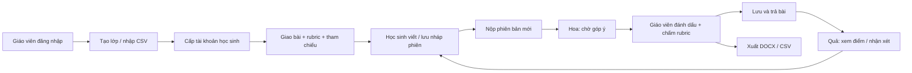

# Vườn Văn — Chức năng hiện có

Khảo sát ngày **19/11/2026**, múi giờ Asia/Ho_Chi_Minh, tại <https://vuon-van-ca-nhan.pages.dev/> bằng hai tài khoản giáo viên và học sinh được cung cấp. Bản trải nghiệm tại `/demo.html` được khảo sát riêng. Đây là hiện trạng quan sát được, không phải danh sách tính năng đề xuất.

## 1. Phạm vi và mức độ xác nhận

- **UI**: đã đăng nhập, mở màn hình hoặc thực hiện tương tác trên website thật.
- **UI + tải xuống**: đã thực hiện và kiểm tra tệp kết quả.
- **Mã**: có đường xử lý trong JavaScript công khai; chưa xác nhận việc ghi dữ liệu thành công trên máy chủ.
- **Demo**: chức năng của bản trải nghiệm lưu trong trình duyệt, không mặc nhiên có ở bản đăng nhập thật.

Không tạo/xóa lớp, cấp/reset tài khoản, thay mật khẩu, giao/nộp/trả bài, thêm tài liệu hoặc gọi AI trên hệ thống thật trong đợt khảo sát. Thử định dạng và đồng hồ chỉ thay đổi dữ liệu trong phiên trình duyệt khảo sát; bản nháp thử đã được xóa. Không lưu mật khẩu, cookie hay token vào tài liệu/evidence.

Dữ liệu quan sát: giáo viên có 2 lớp (`10A1`, `TEST`), 2 học sinh, 1 bài giao `test`, 1 bài nộp chờ chấm. Học sinh có 1 bài được giao; khu vườn hiển thị Mầm 0, Hoa 1, Quả 0. Thư viện hiện trống. Đây là snapshot, không phải dữ liệu mặc định cần hard-code.

Nguồn kiểm chứng:

- [Danh mục ảnh, DOM và computed styles](docs/research/vuon-van-ca-nhan.pages.dev/INDEX.md).
- [Mã giao diện bản thật](docs/research/vuon-van-ca-nhan.pages.dev/source/live.js), [bản trải nghiệm](docs/research/vuon-van-ca-nhan.pages.dev/source/app.js).
- [Ghi nhận request: chỉ method/path/status](docs/research/vuon-van-ca-nhan.pages.dev/network-summary.json).
- [Đặc tả giao diện](DESGIN.MD).

## 2. Vai trò và điều hướng

| Không gian | Mục điều hướng | Quyền/chức năng chính |
|---|---|---|
| Chưa đăng nhập | Đăng nhập; liên kết bản trải nghiệm | Nhập tài khoản do giáo viên cấp hoặc email giáo viên |
| Giáo viên | Góc vườn của tôi; Lớp học; Giao bài; Chấm & trả bài; Rubric; Thư viện | Quản lý lớp, học sinh, nhiệm vụ, đánh giá và tài liệu |
| Học sinh | Góc vườn của tôi; Bài được giao; Rubric; Thư viện | Viết/nộp phiên bản, xem phản hồi, theo dõi tiến độ |
| Bản trải nghiệm | Chuyển vai giáo viên/học sinh ngay trên topbar | Dùng dữ liệu mẫu cục bộ, không cần đăng nhập |

“Khu vườn của em” được mở từ nút **Thăm vườn**, không phải một mục sidebar độc lập. Bản thật chuyển màn hình trong cùng URL `/`, không có các route `/classes`, `/grading`... URL không phản ánh màn hình hiện tại. Mỗi vai trò có thanh điều hướng dưới cùng trên mobile.

## 3. Đăng nhập và tài khoản

| ID | Chức năng | Hành vi, điều kiện | Xác nhận |
|---|---|---|---|
| AUTH-01 | Đăng nhập theo vai trò | Username/email + mật khẩu; hai trường bắt buộc; chuyển vào không gian tương ứng | UI: cả hai tài khoản thành công |
| AUTH-02 | Trạng thái đang đăng nhập | Nút đổi thành “Đang vào vườn…”, `aria-busy=true`, disabled trong xử lý | Mã |
| AUTH-03 | Khôi phục phiên | Gọi `/api/me`, sau đó tải `/api/data`; không xác thực được thì về form | UI + mã; cơ chế lưu/TTL phiên phía server chưa kiểm chứng |
| AUTH-04 | Đổi mật khẩu | 2 trường nhập, 6–128 ký tự, kiểm tra nhập lại trùng nhau | UI form + mã lưu |
| AUTH-05 | Buộc đổi mật khẩu tạm | Nếu profile có `must_change_password`, hiển thị form đổi mật khẩu trước khi vào vườn | Mã; hai tài khoản khảo sát không vào trạng thái này |
| AUTH-06 | Quên mật khẩu | Chỉ có hướng dẫn liên hệ giáo viên phụ trách; không có flow email tự phục hồi | UI |
| AUTH-07 | Đăng xuất | POST `/api/logout`, xóa user trong giao diện và hiển thị form | UI: đã đăng xuất cả hai vai trò, quay lại form đăng nhập |
| AUTH-08 | Lỗi/tải dữ liệu | Panel “Đang mở khu vườn…”; lỗi có “Chưa tải được khu vườn” và “Thử lại”; lỗi tác vụ dùng toast | Mã; không chủ động gây lỗi máy chủ |

Website được khảo sát dùng input password gốc, **không có nút con mắt do ứng dụng tự dựng** trong DOM/CSS. Biểu tượng con mắt và nền autofill xanh trong ảnh người dùng gửi không được coi là tính năng tùy biến đã xác nhận.

## 4. Trang chính

| ID | Chức năng | Chi tiết | Xác nhận |
|---|---|---|---|
| HOME-01 | Dashboard giáo viên | Hero; nút giao bài; liên kết rubric; số lớp, học sinh, bài chờ chấm; ô người chấm; danh sách bài đang mở | UI |
| HOME-02 | Dashboard học sinh | Hero riêng; Thăm vườn; rubric; danh sách bài được giao; không có 4 ô thống kê của giáo viên | UI |
| HOME-03 | Truy cập nhanh bài giao | Xem tất cả → danh sách; giáo viên Xem bài → dialog; học sinh Làm bài → editor | UI |
| HOME-04 | Truy cập thư viện | Card “Ghé thăm Thư viện”, lời giới thiệu, ảnh lọ mực và câu trích dẫn | UI |

Số “BÀI CHỜ CHẤM” tính các submission có trạng thái khác `returned`; mã thêm dấu `+` khi tập submission đang tải có ít nhất 100 phần tử. Đây không được xác nhận là phép đếm toàn bộ lịch sử trên server.

## 5. Quản lý lớp và học sinh — giáo viên

| ID | Chức năng | Chi tiết/ràng buộc | Xác nhận |
|---|---|---|---|
| CLASS-01 | Danh sách lớp | Card tên, năm học, số học sinh theo membership và số bài giao | UI |
| CLASS-02 | Chi tiết lớp | Click card/tên lớp; danh sách họ tên, username; nút cấp tài khoản, đặt lại mật khẩu; quay lại tất cả lớp | UI |
| CLASS-03 | Tạo nhiều lớp | Nút “+ Tạo lớp” thực tế mở “Tạo nhiều lớp”; một năm học, mỗi tên một dòng; trim, loại trùng; 1–50 lớp/lượt, tên ≤100 ký tự, năm ≤30 | UI form + mã xử lý |
| CLASS-04 | Tiến độ tạo lớp | Tạo tuần tự, hiển thị số đã xử lý; giữ lớp đã có; khóa đóng khi đang chạy; cho thử lại khi có lỗi | Mã |
| CLASS-05 | Sửa lớp | Đổi tên/năm học; giữ học sinh và bài viết | UI dialog + mã lưu |
| CLASS-06 | Xóa lớp trống | Dialog xác nhận; không hoàn tác, không xóa tài khoản học sinh | UI dialog + mã xóa; không xác nhận xóa |
| CLASS-07 | Chặn xóa lớp có bài giao | Hiển thị “Chưa thể xóa lớp”, số bài giao và lý do giữ lịch sử | UI: lớp 10A1 |
| CLASS-08 | Chuyển học sinh khi xóa lớp | Nếu có học sinh nhưng chưa giao bài: bắt buộc chọn lớp nhận; chuyển xong mới xóa; giữ tài khoản/mật khẩu | Mã; không có fixture phù hợp để mở nhánh này |
| STUDENT-01 | Cấp tài khoản | Họ tên ≤100 ký tự; username `[a-z0-9_]{3,30}`; chọn lớp | UI form + mã lưu |
| STUDENT-02 | Thông tin tài khoản mới | Hiển thị username và mật khẩu tạm một lần, nút “Đã ghi nhận”; tài khoản đã có giữ mật khẩu | Mã; không tạo tài khoản thử |
| STUDENT-03 | Đặt lại mật khẩu | Dialog cảnh báo mật khẩu cũ mất hiệu lực; “Cấp mật khẩu tạm mới” | UI dialog + mã xử lý |
| IMPORT-01 | Nhập học sinh CSV/TSV | Có mẫu CSV tải về; chấp nhận UTF-8, BOM, dấu phẩy/chấm phẩy/tab, ô quote; tối đa 1 MB, 1–300 học sinh/lượt | UI + mã parser |
| IMPORT-02 | Xem trước và kiểm tra | Cột `ho_ten,ten_dang_nhap,lop,nam_hoc`; báo lỗi số cột, tên, username, lớp/năm, username trùng; chặn nút tạo khi có lỗi | UI: đã thử tệp xem trước với 1 dòng đúng và 1 dòng sai |
| IMPORT-03 | Tạo hàng loạt | Tự tạo lớp thiếu, cấp học sinh theo từng dòng, giữ tài khoản đã có, báo tiến độ và lỗi từng dòng | Mã; chưa thực thi ghi |
| IMPORT-04 | Xuất kết quả nhập | CSV gồm dữ liệu đầu vào, `ket_qua`, `mat_khau_tam`; chỉ xuất mật khẩu mới ở lượt tạo đó; tải trước khi đóng | Mã |

Lưu ý triển khai: trong `teacher()` có handler tạo một lớp cũ, nhưng handler cuối cùng ghi đè bằng `Bulk.classes`. Chức năng hiện đang được gọi từ UI là **tạo nhiều lớp**.

## 6. Giao bài — giáo viên

| ID | Chức năng | Chi tiết/ràng buộc | Xác nhận |
|---|---|---|---|
| TASK-01 | Danh sách bài giao | Tên bài, lớp, tên rubric, thang điểm, nút Xem bài | UI |
| TASK-02 | Xem nội dung bài | Dialog chứa đề bài, ngữ liệu nếu có, nội dung tham chiếu | UI |
| TASK-03 | Tạo bài mới | Tên ≤150 ký tự, lớp, rubric, điểm tối đa, đề bài, ngữ liệu, tham chiếu; phải có lớp trước | UI form + mã ghi |
| TASK-04 | Chọn thang điểm | Mặc định 2; min 0.25, max 100, step 0.25; quy đổi từ thang chuẩn của rubric | UI + mã |
| TASK-05 | Tham chiếu bắt buộc | Không chấp nhận chuỗi chỉ có khoảng trắng | Mã validation |
| TASK-06 | Bật AI sơ bộ | Checkbox, nhãn nêu tối đa 2 lượt/học sinh/nhiệm vụ và dùng API của chủ website | UI checkbox; giới hạn server/API AI chưa kiểm chứng |

Bản thật ghi rõ: **chưa hỗ trợ sửa bài giao hoặc hạn nộp tự động**; rubric và thang điểm giữ nguyên sau khi giao. Không có màn hình xóa bài giao trong UI đã khảo sát.

## 7. Viết và nộp bài — học sinh

| ID | Chức năng | Hành vi | Xác nhận |
|---|---|---|---|
| WRITE-01 | Mở nhiệm vụ | Tải lịch sử submission theo bài, đọc đề/ngữ liệu, xem tiêu chí đánh giá bên cạnh | UI |
| WRITE-02 | Soạn văn bản có định dạng | Contenteditable; đậm, nghiêng, gạch chân, 5 màu chữ, xóa định dạng; có tooltip phím Ctrl+B/I/U | UI; đã thử nhập và in đậm trong nháp cục bộ |
| WRITE-03 | Paste/drop | Paste lấy plain text; drop bị chặn; lưu nội dung thành text + các vùng định dạng | Mã |
| WRITE-04 | Đếm từ | Cập nhật khi nhập; tách theo khoảng trắng, bỏ token chỉ có dấu câu; “học sinh” tính 2 | UI: câu thử 5 từ |
| WRITE-05 | Lưu nháp trong phiên | Text + formatting lưu `sessionStorage` theo user/bài; chưa đồng bộ server trước khi nộp | UI + mã; không phải autosave đa thiết bị |
| WRITE-06 | Giải thích chỉnh sửa | Textarea riêng, maxlength 3000 | UI |
| WRITE-07 | Nộp phiên bản mới | Gửi assignment ID, text, formatting, note; giữ bất biến bản đã nộp; tạm dừng đồng hồ | UI nút + mã gửi; chưa nộp thật |
| WRITE-08 | Lịch sử nộp | Accordion theo ngày giờ, trạng thái, nội dung; mục đầu mở mặc định; tải từng trang 50 dòng | UI với 1 bản nộp; phân trang: mã |
| WRITE-09 | Xem bài đã trả | Điểm sau quy đổi, nhận xét chung, highlight, bình luận trích đoạn | Mã; dữ liệu thật chưa có bản đã trả |
| CLOCK-01 | Bật/ẩn đồng hồ | Lần mở đầu tự chạy; hiển thị HH:MM:SS và cây SVG | UI |
| CLOCK-02 | Điều khiển thời gian | Tạm dừng, tiếp tục, đặt lại; mốc nở hoa mặc định 30 phút, giới hạn 1–240 | UI + mã giới hạn |
| CLOCK-03 | Cây theo tiến độ | Mầm → Chồi → Nụ → Hoa theo thời gian/mốc; trạng thái nằm trong sessionStorage ở bản thật | UI Mầm; các pha sau: mã |

Giới hạn cần phân biệt: textarea nguồn có `maxlength=30000`, nhưng được ẩn và thay bằng contenteditable, `required` bị bỏ. Chưa xác nhận giới hạn 30.000 ký tự và kiểm tra rỗng có được cưỡng chế ở server; không mô tả chúng như validation UI đã chắc chắn hoạt động. Trường giải thích chỉnh sửa không có cơ chế lưu nháp như phần bài làm trong mã hiện tại.

## 8. Khu vườn tiến độ — học sinh

| Nhóm | Quy tắc theo bản nộp mới nhất | Khi nhóm trống |
|---|---|---|
| **Mầm** — bài đang viết | Chưa có submission cho bài được giao | “Em đã nộp tất cả bài được giao.” |
| **Hoa** — bài chờ góp ý | Đã nộp, trạng thái mới nhất khác `returned` | “Hiện chưa có bài đang chờ góp ý.” |
| **Quả** — bài đã nhận xét | Bản mới nhất có trạng thái `returned` | “Những bài được trả nhận xét sẽ xuất hiện ở đây.” |

- **GARDEN-01, UI:** ba card ảnh, tên nhóm, số lượng và mô tả; mỗi đề chỉ tính một lần.
- **GARDEN-02, UI:** click card lọc danh sách và bật `aria-pressed`; tiêu đề danh sách đổi theo nhóm. Đã mở cả ba nhóm.
- **GARDEN-03, UI:** “Xem tất cả” bỏ chọn nhóm; “Mở bài” vào editor.
- **GARDEN-04, Mã:** chọn bản mới nhất theo version nếu cả hai có version, nếu không so createdAt và ID khi trùng thời điểm. Không phân loại theo điểm số hay độ dài nháp.

## 9. Chấm và trả bài — giáo viên

| ID | Chức năng | Chi tiết/ràng buộc | Xác nhận |
|---|---|---|---|
| REVIEW-01 | Bàn chấm bài | Bảng học sinh/bài giao, trạng thái, Chấm sửa | UI |
| REVIEW-02 | Tải thêm | Nút hiện khi đã tải ≥100 submission; “Xem thêm bài nộp”, hết dữ liệu đổi nhãn | Mã; chưa có đủ dữ liệu thử |
| REVIEW-03 | Đọc bản gốc và tham chiếu | Bài làm giữ định dạng, đếm từ; accordion tham chiếu | UI |
| REVIEW-04 | Tô màu đoạn chọn | 4 màu Vàng/Xanh lá/Hồng/Xanh lam; tối đa 50 đánh dấu, vùng chọn ≤2000 ký tự | UI công cụ; giới hạn: mã |
| REVIEW-05 | Bình luận theo đoạn | Chọn văn bản → Bình luận → nhập nội dung → Lưu bình luận/Hủy; sửa ghi chú, xóa đánh dấu | UI mở editor; lưu/sửa/xóa cục bộ: mã |
| REVIEW-06 | Rà lỗi cơ bản | Chính tả theo một số mẫu, từ lặp, khoảng trắng trước dấu câu, nhiều dấu cách; có thể ghi gợi ý vào bài | UI chạy bộ rà; mẫu lỗi: mã |
| REVIEW-07 | Chấm theo tiêu chí | Một select mỗi tiêu chí; tùy chọn “Chưa chấm”; accordion mô tả mức điểm | UI |
| REVIEW-08 | Nhận xét chung | Textarea, tối đa 5000 ký tự | UI + mã |
| REVIEW-09 | Lưu và trả bài | Bắt buộc chọn điểm cho mọi tiêu chí; gửi scores, comments, overall; chuyển trạng thái bài | UI nút + mã gửi; chưa trả bài thật |
| REVIEW-10 | AI góp ý sơ bộ | Chỉ hiện nút nếu nhiệm vụ bật AI và chưa có `ai_feedback`; kết quả là văn bản để giáo viên duyệt | Mã; bài hiện có không bật AI |
| REVIEW-11 | Xuất DOCX | “Xuất bản đã lưu”, gồm đề, bài gốc/format/highlight, rubric, nhận xét, góp ý; không tự lưu các thay đổi đang chấm | UI + tải xuống: tệp ZIP DOCX hợp lệ |
| REVIEW-12 | Xuất CSV bảng điểm | Tất cả lần nộp, học sinh/lớp/bài/rubric, điểm từng tiêu chí và nhận xét; điểm/nhận xét chờ trả để trống | UI + tải xuống: 1 dòng dữ liệu |

Công thức: `round((sum(scores) / rubric.max) × assignment.scale × 100) / 100`. Chỉ làm tròn tổng đến 2 chữ số thập phân. Bộ rà lỗi theo quy tắc không phải AI và không tự trừ điểm.

Trong bản thật, đánh dấu/bình luận đang chỉnh nằm trong bộ nhớ giao diện cho tới **Lưu và trả bài**. Không có nút lưu nháp chấm điểm như demo. CSV dùng UTF-8 BOM, escape ô và phòng công thức bảng tính; DOCX được tạo phía trình duyệt, có giữ các vùng formatting/highlight. [Kết quả kiểm tra xuất tệp](docs/research/vuon-van-ca-nhan.pages.dev/export-verification.json).

## 10. Rubric dùng chung

| ID nguồn | Bộ rubric | Điểm chuẩn | Số tiêu chí |
|---|---|---|---|
| `0` | Đoạn nghị luận xã hội | 2 | 5 |
| `1` | Đoạn nghị luận văn học | 2 | 5 |
| `2` | Bài nghị luận xã hội | 4 | 8 |
| `3` | Bài nghị luận văn học | 4 | 8 |

**RUBRIC-01, UI:** chuyển giữa 4 tab; mỗi tiêu chí là accordion mở độc lập, có các mức điểm và mô tả nguyên văn. **RUBRIC-02, UI:** dùng cùng rubric khi giao bài, học sinh xem yêu cầu và giáo viên chấm. **RUBRIC-03, Mã:** bộ rubric cố định trong [rubrics.js](docs/research/vuon-van-ca-nhan.pages.dev/source/rubrics.js); không có editor tạo/sửa rubric cá nhân trong bản thật. Nên dùng nguyên dữ liệu này để tránh lệch nội dung và chiều cao giao diện.

## 11. Thư viện

| ID | Chức năng | Chi tiết/ràng buộc | Xác nhận |
|---|---|---|---|
| LIB-01 | Danh sách tài liệu | Tên, nhóm, tác giả/nguồn; “Đọc” hoặc “Mở liên kết”; trạng thái trống | UI trống; item có dữ liệu: mã |
| LIB-02 | Thêm tài liệu — giáo viên | Accordion; tên ≤180 ký tự, nguồn ≤300, danh mục, phương thức, mục giới thiệu, đoạn trích ≤600 | UI cả hai phương thức |
| LIB-03 | Phân loại tài liệu | Hướng dẫn; Bài văn hay; Ngữ liệu; Tài liệu khác | UI; không có bộ lọc theo danh mục |
| LIB-04 | Upload PDF/TXT | ≤2 MB; kiểm tra đuôi; PDF kiểm tra `%PDF-`; quá dung lượng tự đổi sang nhập liên kết | UI field + mã kiểm tra/upload |
| LIB-05 | Chia sẻ liên kết | HTTPS hợp lệ, không user/password trong URL, dài ≤4096; mở tab mới; nhắc cấp quyền Drive/Docs | UI field + mã kiểm tra |
| LIB-06 | Slot giới thiệu | Chỉ lưu trong thư viện / Một chút gợi mở / Chậm một chút, đọc sâu hơn.; chọn slot cần có excerpt | UI + mã; xem lưu ý bên dưới |
| LIB-07 | Đọc/tải file | Dialog PDF bằng iframe; TXT bằng văn bản pre-wrap; nút tải tài liệu; có đóng dialog | Mã; thư viện thật chưa có file để xác nhận |
| LIB-08 | Yêu thích | Lưu/bỏ lưu từng tài liệu; chuyển “Tất cả tài liệu” / “★ Yêu thích”; `aria-pressed` theo bộ lọc | UI đổi bộ lọc rỗng; lưu/bỏ lưu: mã |

Lưu ý hiện trạng: form mô tả slot/đoạn trích xuất hiện ở trang chính, nhưng `Shelf.cards()` hiện dựng card dẫn tới thư viện và câu trích dẫn tĩnh, không đọc tài liệu từ provider. Vì vậy không xác nhận “đoạn trích mới nhất trên trang chính” là chức năng đang hoạt động. Chưa thấy tìm kiếm, phân trang, sửa/xóa tài liệu hoặc cấu hình quyền chia sẻ theo lớp trong UI.

## 12. Chức năng riêng của bản trải nghiệm

| Chức năng | Khác với bản thật |
|---|---|
| Chuyển vai tức thời | Không đăng nhập, chọn giáo viên/học sinh bằng topbar |
| Dữ liệu mẫu | `localStorage` cho lớp/bài/nháp/chấm; IndexedDB cho tài liệu, tệp và yêu thích |
| Lớp mẫu và mã tham gia | Card có mã tham gia; thêm học sinh mẫu, không cấp mật khẩu thật |
| Sửa bài giao, trường hạn nộp | Có trong form demo; khi có bài nộp thì chặn thay rubric/thang điểm |
| Bàn chấm phong phú hơn | Hiển thị phiên bản, điểm, tổng quy đổi trực tiếp; Lưu nháp; dialog xem các phiên bản |
| Phản hồi góp ý | Mã demo cho học sinh “Trao đổi về góp ý này”; không thấy flow tương ứng trong bản thật |
| Nháp học sinh | Lưu localStorage có debounce 500ms; có thể lấy nội dung bản nộp gần nhất làm nháp |
| Nút AI học sinh | Click hiển thị thông báo chưa kết nối AI, không gọi API thật |

Đã mở trang chính, form sửa bài, bàn chấm, dialog phiên bản, editor học sinh và thông báo AI demo. Các nhánh trả bài/trao đổi và tạo dữ liệu demo còn lại xác nhận bằng mã, chưa chạy toàn bộ vòng đời. Không dùng screenshot demo làm baseline thay cho màn hình live tương ứng.

## 13. Những gì chưa có hoặc chưa đủ căn cứ

- Không thấy tự đăng ký, đăng nhập mạng xã hội, tự reset mật khẩu qua email.
- Không thấy chức năng chat chung, thông báo đẩy, thanh toán, quản trị toàn hệ thống hoặc màn hình cài đặt AI.
- Chưa kiểm thử cưỡng chế phân quyền ở API, TTL phiên, giới hạn/rate limit, điều kiện xung đột khi nhiều người cùng lưu, thành công end-to-end các POST nghiệp vụ.
- Chưa có dữ liệu thật để quan sát bài đã trả, nhiều trang submission, tài liệu PDF/TXT, tài liệu yêu thích hay phản hồi AI.
- Các trạng thái thiếu dữ liệu đã được đánh dấu **Mã**; không coi là đã chạy thành công chỉ vì có nút hoặc handler.

## 14. Luồng nghiệp vụ tổng quát

Luồng thể hiện các nhánh được hỗ trợ trong giao diện/mã; đợt khảo sát không thực hiện các bước ghi dữ liệu thật để hoàn tất toàn bộ vòng đời.
