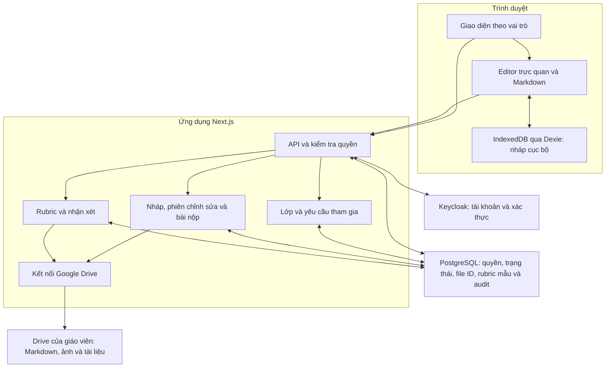
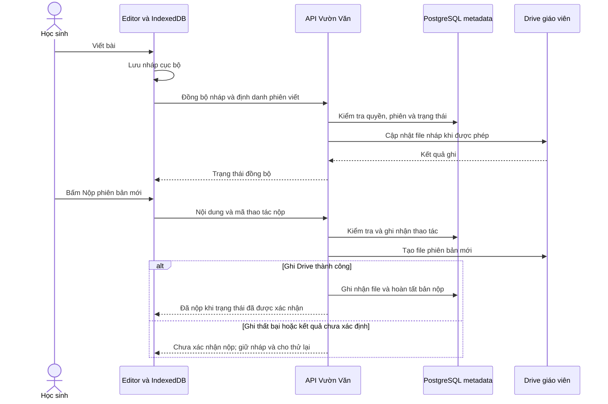

# Vườn Văn · Lit Garden

**Không gian sáng tạo và kết nối cho việc dạy, học và chăm chút từng trang viết.**

Vườn Văn giúp giáo viên quản lý lớp, giao bài, chấm theo rubric và góp ý trực tiếp trên bài viết. Học sinh soạn Markdown, lưu nháp, nộp nhiều phiên bản và theo dõi tiến bộ qua khu vườn **Mầm → Hoa → Quả**.

Nội dung học tập chính thức được lưu trên **Google Drive của giáo viên**. Học sinh sử dụng Vườn Văn bằng tài khoản được cấp, không cần tài khoản Google hoặc quyền truy cập Drive trực tiếp.

## Trạng thái dự án

Repo hiện có tài liệu khảo sát, đặc tả chức năng, thiết kế giao diện, bằng chứng tham chiếu và [prototype kiểm chứng editor](prototypes/editor/README.md). **Chưa có mã ứng dụng sản phẩm hoặc cấu hình triển khai.** Các sơ đồ dưới đây mô tả kiến trúc mục tiêu.

| Hạng mục | Trạng thái |
|---|---|
| Khảo sát hệ thống tham chiếu bằng hai vai trò | Hoàn thành; có 82 ảnh theo màn hình/trạng thái/viewport |
| Đặc tả giao diện nguồn | Có màu, font, spacing, responsive, DOM và computed styles; đã đối chiếu 17 giá trị token/layout |
| Phạm vi Admin–Drive–Markdown | Đã thống nhất các quyết định nghiệp vụ qua phiên thiết kế |
| Review chức năng tham chiếu | Đã xác nhận thêm 42 quyết định về vòng đời bài/lớp, chấm, rubric, thư viện và thông báo |
| Stack công nghệ | Có đề xuất làm cơ sở triển khai; xem phần bên dưới |
| Editor và annotation | Có spike MDXEditor 4.5.0: Markdown hai chiều, phục hồi review và adapter ảnh qua backend mock; [kết luận/giới hạn](docs/technical/EDITOR-VALIDATION.md) |
| Đồng bộ và ảnh Drive thật | Chưa kiểm chứng OAuth/Drive live; chưa tích hợp ứng dụng |
| Ứng dụng mới và mức khớp giao diện >90% | Chưa triển khai/chưa đo trên bản clone |

Website được khảo sát: [vuon-van-ca-nhan.pages.dev](https://vuon-van-ca-nhan.pages.dev/). Đây là nguồn tham chiếu; không phải bản triển khai từ repo này.

## Tài liệu chính

| Tài liệu | Nội dung |
|---|---|
| [FEATURES.MD](FEATURES.MD) | Hiện trạng hệ thống tham chiếu; phân biệt chức năng quan sát được, xác nhận từ mã và chức năng riêng của demo |
| [DESGIN.MD](DESGIN.MD) | Đặc tả dựng giao diện, tokens, responsive và tiêu chí pixel-diff; tên file giữ theo yêu cầu ban đầu |
| [Admin–Drive–Markdown](docs/requirements/ADMIN-DRIVE-MARKDOWN.md) | 24 quyết định, quyền truy cập, luồng lưu nội dung, lỗi và điều kiện nghiệm thu |
| [Kiểm chứng editor](docs/technical/EDITOR-VALIDATION.md) | Prototype, ma trận kết quả, evidence, hạn chế mock/live và contract đề xuất cho schema/giao thức |
| [Review chức năng](docs/requirements/FEATURES-REVIEW.md) | 42 quyết định bổ sung từ phiên grill FEATURES: vòng đời bài/lớp, chấm, hội thoại, rubric, thư viện và thông báo |
| [Chi tiết màn hình](docs/design/SCREENS.md) | Bố cục và thông số từng màn hình tham chiếu |
| [Tương tác](docs/design/INTERACTIONS.md) | Hover, focus, dialog, editor, timer và các trạng thái đã khảo sát |
| [Danh mục bằng chứng](docs/research/vuon-van-ca-nhan.pages.dev/INDEX.md) | Ảnh, DOM, số đo, source, font và asset manifest |

`FEATURES.MD` mô tả bản gốc, còn đặc tả Admin–Drive–Markdown mô tả sản phẩm mục tiêu. Khi có khác biệt — ví dụ quyền reset học sinh, nơi lưu nháp hoặc định dạng editor — áp dụng quyết định của sản phẩm mục tiêu.

Các quyết định mới tại [Review chức năng](docs/requirements/FEATURES-REVIEW.md) được ưu tiên khi khác với mô tả trước: admin quản lý rubric chung trong database; bản rubric của bài đã giao lưu trên Drive; nháp chấm tách khỏi các lần công bố. Bản đầu không có AI, demo công khai, xuất DOCX hoặc phương thức thêm liên kết ngoài vào thư viện.

## Mô hình sử dụng đã chốt

Giáo viên hoạt động độc lập, mỗi người quản lý lớp và Drive riêng. Một học sinh dùng **một tài khoản chung** để tham gia lớp của nhiều giáo viên; quyền đọc/ghi nội dung luôn được kiểm tra theo lớp và giáo viên phụ trách.

| Vai trò | Quyền chính |
|---|---|
| **Admin** | Cấp tài khoản giáo viên, khóa/mở khóa giáo viên, xem trạng thái kết nối, reset mật khẩu học sinh, quản lý rubric dùng chung; không đọc bài, điểm hay nhận xét bằng role admin |
| **Giáo viên** | Quản lý lớp, cấp học sinh mới từng người/CSV, duyệt tham gia lớp, kết nối Drive, giao bài, chấm rubric và nhận xét |
| **Học sinh** | Xin tham gia lớp bằng mã lớp, viết bài, lưu nháp, nộp phiên bản mới, xem kết quả và tiến độ của mình |

- Tài khoản giáo viên và học sinh được cấp mật khẩu tạm; bắt buộc đổi ở lần đăng nhập đầu.
- Giáo viên không reset tài khoản học sinh dùng chung. Admin đảm nhiệm việc này.
- Học sinh đã có tài khoản nhập mã lớp và chờ giáo viên duyệt trước khi xem đề hoặc nộp bài. CSV trùng username không được đổi mật khẩu hoặc tự thêm học sinh đó vào lớp.
- Giáo viên được chuẩn bị lớp và tài khoản trước khi kết nối Drive; phải hoàn tất kết nối và chọn thư mục trước khi sử dụng chức năng tạo nội dung.
- Khi giáo viên bị khóa, học sinh chỉ xem dữ liệu đã lưu nếu Drive còn truy cập được, không sửa/nộp thêm vào không gian đó. Các lớp của giáo viên khác không bị ảnh hưởng.
- Admin là người vận hành được tin cậy. Phân quyền theo role không ngăn được việc đăng nhập bằng mật khẩu tạm mà admin biết; mọi lần cấp/reset cần có nhật ký không chứa mật khẩu.

## Vòng đời chức năng đã chốt

### Giao bài và tiến độ

- Tự lưu nháp bài giao lên Drive. Học sinh chỉ thấy sau khi giáo viên bấm **Giao bài**; đề, rubric và thang điểm cố định từ thời điểm đó. Muốn đổi đề phải tạo bài mới.
- Hạn nộp không bắt buộc; quá hạn vẫn được nộp và đánh dấu trên từng phiên bản. Được gia hạn, không rút ngắn hạn đã công bố; thông báo cho học sinh, tính lại nhãn nộp muộn và giữ lịch sử đổi hạn.
- Giáo viên đóng/mở lại bài thủ công. Khi đóng, học sinh chỉ đọc/tải nháp, không sửa/nộp thêm; giáo viên vẫn chấm và hai bên vẫn trao đổi.
- Tham chiếu không bắt buộc, mặc định riêng tư. Được công khai khi bài đã đóng, sau đó không mở lại bài. Chỉ học sinh đã được giao bài mới đọc được; giáo viên dùng thư viện để chia sẻ cho người vào sau.
- Hàng chờ ưu tiên bản nộp mới nhất, vẫn giữ nháp chấm và quyền chấm các bản cũ. Kết quả tổng hợp chỉ xét bản nộp mới nhất: chưa trả thì hiện **Chờ chấm**, không lấy điểm bản cũ thay thế.
- Trang chính/khu vườn tổng hợp các lớp đang tham gia và lọc theo lớp/giáo viên. Bài đóng chưa nộp không tính vào Mầm, vẫn có trong danh sách; mở lại thì trở về Mầm.
- Giữ đồng hồ tập trung trên thiết bị; không dùng để chấm điểm hoặc thống kê thời gian học. Giải thích chỉnh sửa không bắt buộc, tự lưu cùng nháp và gắn với từng lần nộp.

### Chấm, trao đổi và thông báo

- Nháp chấm tự lưu trên Drive, tách khỏi kết quả công bố. **Trả bài** phải đủ điểm mọi tiêu chí; nhận xét chung không bắt buộc.
- Mỗi lần **Trả bài/Trả lại bài** tạo bản công bố mới. Chỉ giáo viên xem lịch sử sửa kết quả; học sinh thấy kết quả hiện hành của từng phiên bản bài nộp.
- Hội thoại nhiều lượt gắn với nhận xét đã trả và đúng bản nộp. Nhận xét có phản hồi không được sửa/xóa; tin nhắn đã gửi cũng không sửa/xóa. Đính chính bằng tin mới.
- Giữ nút rà lỗi theo quy tắc để giáo viên chọn gợi ý; không tự sửa bài hoặc trừ điểm. Không có AI trong bản đầu.
- Thông báo trong ứng dụng có trạng thái chưa đọc và dẫn tới bài/nhận xét liên quan; chưa có email/push.
- Giữ xuất CSV bảng điểm và tải Markdown theo quyền đọc; chưa xuất DOCX.

### Lớp và thư viện

- Lớp được lưu trữ/khôi phục; khi lưu trữ chỉ đọc lịch sử, dừng giao bài, viết, nộp, chấm và trao đổi.
- Chỉ giáo viên đưa học sinh ra khỏi lớp. Học sinh vẫn đọc bài đã nộp, đề tương ứng và nhận xét đã trả của mình; mất quyền đọc thư viện/bài chưa nộp và không được ghi thêm. Nhận lại thì khôi phục membership cùng lịch sử.
- Học sinh mới vào lớp tự nhận các bài đang mở, kể cả đã quá hạn; không nhận bài đóng.
- Thư viện hỗ trợ PDF/TXT và tài liệu Markdown, mặc định riêng tư, chia sẻ cho một hoặc nhiều lớp. Không có phương thức thêm liên kết ngoài.
- Giáo viên được sửa/thay tài liệu; nội dung mới hiển thị khi **Lưu thay đổi**, giữ phạm vi chia sẻ và lượt yêu thích. Xóa khỏi thư viện sẽ chuyển file do ứng dụng quản lý vào thùng rác Drive.
- Giáo viên chọn tài liệu nổi bật theo lớp để hiện trên trang chính; chỉ hiển thị với người có quyền đọc.

## Kiến trúc tổng thể

Hướng triển khai đề xuất là **một ứng dụng Next.js gồm giao diện và API**, chia thành các module nghiệp vụ rõ ràng. Keycloak quản lý xác thực; PostgreSQL quản lý dữ liệu vận hành; Drive lưu nội dung chính thức; IndexedDB giữ nháp trên thiết bị.



Các cạnh tới PostgreSQL biểu diễn dữ liệu quản lý và rubric mẫu dùng chung, không phải bản sao bài viết hay nhận xét. Backend có thể đọc/ghi nội dung qua Drive trong lúc xử lý yêu cầu; không giữ nội dung bài viết/nhận xét lâu dài trên máy chủ.

## Stack công nghệ đề xuất

Các nguyên tắc sở hữu dữ liệu và nghiệp vụ ở trên đã được chốt. Bảng này ghi lựa chọn công nghệ đã đề xuất trong thảo luận; dependency được khóa riêng trong prototype editor, chưa scaffold ứng dụng sản phẩm.

| Phần | Đề xuất | Vai trò / điểm cần lưu ý |
|---|---|---|
| Web và API | **Next.js + React + TypeScript** | Một codebase; Route Handlers gọi các service nghiệp vụ, editor chạy phía trình duyệt |
| UI | **CSS Modules + Radix Primitives dùng chọn lọc** | Bám tokens và số đo gốc; HTML native cho control đơn giản. shadcn/ui đã được so sánh nhưng chưa được chọn thay Radix |
| Xác thực | **Keycloak + OpenID Connect** | Username/password, mật khẩu tạm, buộc đổi lần đầu, quản lý phiên và khóa tài khoản; cần theme đăng nhập theo Vườn Văn |
| Dữ liệu quản lý | **PostgreSQL + Drizzle ORM** | Lớp, membership, trạng thái, định danh file, phiên chỉnh sửa và audit |
| Soạn thảo | **MDXEditor** | Spike khuyến nghị 4.5.0 kèm plugin giữ hard-break, gate Markdown và renderer annotation riêng; ảnh chỉ mới kiểm chứng qua mock |
| Nháp trên thiết bị | **Dexie.js / IndexedDB** | Lưu nháp và trạng thái chưa đồng bộ; logic đồng bộ Drive do ứng dụng xây dựng |
| Nội dung chính thức | **Google Drive API + Google Picker** | Giáo viên chọn thư mục cha; ứng dụng đọc/ghi file theo quyền được cấp |
| Kiểm thử | **Vitest + Playwright** | Logic nghiệp vụ, phân quyền, luồng nhiều thiết bị, E2E và so screenshot |
| Triển khai | **Docker + GitHub Actions** | Next.js chạy Node; Keycloak là dịch vụ riêng; PostgreSQL managed là hướng đề xuất cho production |

Keycloak phù hợp với luồng cấp username/mật khẩu tạm và không bắt buộc học sinh có email; cần cấu hình user profile tương ứng. Đổi lại, phải vận hành thêm một dịch vụ và thiết kế theme cho các trang xác thực. [Keycloak administration](https://www.keycloak.org/docs/latest/server_admin/index.html)

MDXEditor hỗ trợ chế độ trực quan/mã nguồn. Tô màu, bình luận theo đoạn và khôi phục annotation từ file nhận xét là phần nghiệp vụ cần xây riêng. Plugin ảnh cũng cần được giới hạn để không sinh HTML ngoài định dạng nội dung đã thống nhất. [Source mode](https://mdxeditor.dev/editor/docs/diff-source), [images](https://mdxeditor.dev/editor/docs/images)

Radix xử lý các hành vi như focus và bàn phím, còn CSS Modules định hình giao diện. Lựa chọn thư viện UI không tự bảo đảm đạt mức khớp pixel. [Radix Primitives](https://www.radix-ui.com/primitives/docs/overview/introduction)

## Ranh giới lưu trữ

| Nơi lưu | Dữ liệu |
|---|---|
| **Keycloak** | Danh tính, thông tin xác thực, phiên và cấu hình xác thực |
| **PostgreSQL ứng dụng** | Liên kết tài khoản, vai trò/quyền nghiệp vụ, lớp, membership, yêu cầu tham gia, thông tin quản lý bài giao, trạng thái nộp/trả, file ID, dấu kiểm tra toàn vẹn, quyền chỉnh sửa tạm thời, audit, rubric mẫu dùng chung và metadata thông báo không chứa nguyên văn bài/nhận xét |
| **Kho thông tin kết nối phía server** | Định danh Google, folder ID, refresh token được mã hóa; thiết kế cụ thể thuộc bước triển khai |
| **Drive giáo viên** | Đề bài, ngữ liệu, tham chiếu, bản rubric cố định khi giao bài, nháp đã đồng bộ, từng bản nộp, nháp chấm, các lần công bố điểm/nhận xét/đánh dấu, hội thoại, tài liệu và ảnh |
| **IndexedDB trên thiết bị** | Nháp cục bộ, phiên bản đã đồng bộ gần nhất và trạng thái thay đổi chưa lên Drive |

Nội dung bài và nhận xét không được giữ lâu dài trong database ứng dụng, log request, cache server, bản sao ảnh trên server hoặc payload hàng đợi. Nếu cần tác vụ nền, dữ liệu tác vụ chỉ chứa thông tin quản lý/tham chiếu; không dùng hàng đợi làm nơi lưu bản nháp thứ hai.

Rubric mẫu là ngoại lệ cấu hình dùng chung đã chốt: admin quản lý trong database, giáo viên chỉ chọn. Cập nhật hoặc ngừng sử dụng rubric mẫu không thay bản rubric/thang điểm đã cố định của bài giao cũ.

**Dexie không thực hiện đồng bộ Drive.** Nó cung cấp API làm việc với IndexedDB; ứng dụng điều phối lưu cục bộ và đồng bộ. Nháp chưa lên Drive chỉ có trên thiết bị đã viết, và có thể mất nếu người dùng xóa dữ liệu trình duyệt. [Dexie documentation](https://dexie.org/docs/Dexie.js)

## Đăng nhập và kết nối Drive

Đăng nhập Vườn Văn và kết nối Google Drive là hai luồng riêng. Học sinh không cần thực hiện Google OAuth.

1. Admin cấp tài khoản giáo viên; giáo viên đổi mật khẩu tạm.
2. Giáo viên kết nối Google Drive và chọn thư mục cha bằng Picker.
3. Ứng dụng tạo thư mục **Vườn Văn** bên trong, ghi nhận kết nối với giáo viên tương ứng.
4. Backend kiểm tra phiên đăng nhập, vai trò, lớp và trạng thái giáo viên trước mỗi yêu cầu đọc/ghi nội dung.
5. Backend dùng quyền Drive được cấp để thao tác file; học sinh nhận nội dung qua ứng dụng.

Hướng kỹ thuật là ưu tiên scope `drive.file`, kiểm chứng với luồng chọn parent folder và quản lý file do ứng dụng tạo. Refresh token chỉ được lưu an toàn phía server. Phạm vi OAuth không thay thế kiểm tra quyền theo lớp trong ứng dụng. [Google Drive scopes](https://developers.google.com/workspace/drive/api/guides/api-specific-auth)

Sau khi có dữ liệu, bản đầu chỉ hỗ trợ kết nối lại **cùng tài khoản Google**. Chưa hỗ trợ chuyển toàn bộ dữ liệu sang tài khoản khác. Khóa tài khoản giáo viên không xóa file trên Drive.

## Markdown, phiên bản và nhận xét

Editor mặc định trực quan, có nút chuyển sang mã Markdown cho cả giáo viên và học sinh. Nội dung hỗ trợ tiêu đề, đậm/nghiêng, danh sách, bảng, trích dẫn và liên kết; bỏ màu chữ và gạch chân của editor gốc. Chỉ giáo viên được chèn ảnh, kể cả khi thao tác qua mã nguồn.

Cấu trúc thư mục minh họa; tên file và schema metadata sẽ được xác định trong thiết kế kỹ thuật:

```text
<Thư mục cha được chọn>/
└── Vườn Văn/
    └── <Lớp>/
        └── <Bài giao>/
            ├── de-bai.md
            ├── tham-chieu.md
            ├── rubric.md
            ├── assets/
            └── <Học sinh>/
                ├── bai-lam.draft.md
                ├── lan-01.md
                ├── lan-01.review.draft.md
                ├── lan-01.review-01.md
                ├── lan-01.review-02.md
                ├── lan-02.md
                └── lan-02.review.draft.md
```

- Nháp có thể cập nhật; **mỗi lần nộp tạo một file mới**. Editor không sửa lại file đã nộp.
- Mỗi bản nộp có nháp chấm riêng; mỗi lần công bố tạo file review Markdown mới, chứa điểm, nhận xét và dữ liệu có cấu trúc để khôi phục đánh dấu. Không dùng file `.json` phụ cho dữ liệu chấm. Schema hội thoại cần thiết kế riêng, chưa được thể hiện trong cây minh họa này.
- Giữ tô màu, bình luận theo đoạn và rubric. Chấm bài không thay nội dung file gốc.
- Annotation phải gắn với đúng phiên bản và nội dung; không tự chuyển đánh dấu của bản cũ sang bản mới.
- Cách biểu diễn metadata trong `.review.md`, quyền sửa từng phần và hiển thị ảnh Drive riêng tư cần được kiểm chứng bằng prototype.
- Cây thư mục không phải cơ chế phân quyền: backend vẫn phải bảo vệ tham chiếu giáo viên, bài của người khác và nhận xét chưa trả.

## Nháp, đồng bộ và nộp bài

Nháp lưu cục bộ khi nhập, rồi tự đồng bộ Drive khi kết nối hoạt động. Thiết bị khác chỉ đọc được bản đã đồng bộ gần nhất. Lưu nháp không thay cho hành động nộp bài.

Trong ứng dụng, giáo viên chỉ đọc bài đã nộp, không mở nháp học sinh. Quyền này không ngăn chủ Drive đọc file nháp trực tiếp trên Drive của mình.



Sơ đồ là luồng nghiệp vụ mục tiêu. Drive và PostgreSQL không nằm trong cùng một transaction: thiết kế phải xử lý cả trường hợp file đã được tạo nhưng bước ghi nhận metadata bị lỗi. Mã thao tác ổn định và cơ chế đối chiếu trạng thái phải giúp thử lại mà không tạo trùng phiên bản ngoài ý muốn.

Khi nộp thất bại, giữ nháp cục bộ, cho tải `.md` và thử lại. **Không tự nộp lại thay học sinh.** Đồng bộ nháp nền không được tự phát sinh bản nộp chính thức.

### Một nháp, một phiên chỉnh sửa

Mỗi nháp chỉ có một tab/thiết bị được chỉnh sửa. Nơi mở sau chỉ xem, có nút **Tiếp tục viết tại đây** để chuyển quyền viết. Phiên trước dừng đồng bộ và giữ phần chưa lưu cục bộ.

Hướng kỹ thuật đề xuất là lưu quyền chỉnh sửa có thời hạn cùng định danh phiên trong PostgreSQL và kiểm tra tại mỗi lần ghi. Cần xử lý cả request cũ đang chạy khi chuyển quyền, không chỉ vô hiệu hóa nút trên giao diện. Thời hạn, heartbeat và cơ chế điều phối ghi chưa được triển khai.

## Các tình huống lỗi phải hỗ trợ

| Tình huống | Hành vi đã thống nhất |
|---|---|
| Mất mạng, Drive hết dung lượng hoặc mất quyền truy cập | Giữ nháp cục bộ; báo chưa đồng bộ/chưa nộp; cho tải `.md` và thử lại |
| Mở nháp trên thiết bị khác | Hiển thị bản đã đồng bộ gần nhất; chỉ một phiên có quyền viết |
| File bài nộp bị sửa ngoài Vườn Văn | Báo xung đột, tạm khóa chấm phiên bản bị ảnh hưởng; không tự chấp nhận làm bài gốc |
| File bị xóa | Báo không tìm thấy; các phiên bản khác còn tồn tại vẫn hoạt động |
| Giáo viên bị khóa | Không cho giáo viên đăng nhập; học sinh chỉ đọc dữ liệu đã lưu nếu Drive còn hoạt động |
| Muốn đổi Drive sau khi có dữ liệu | Bản đầu chỉ cho kết nối lại cùng tài khoản, chưa hỗ trợ di chuyển |

Do không có bản sao nội dung lâu dài trên server, ứng dụng không bảo đảm khôi phục file gốc đã bị sửa/xóa trên Drive. Dấu kiểm tra toàn vẹn giúp phát hiện thay đổi, không khôi phục nội dung đã mất.

## Giao diện và kiểm thử

Giao diện tham chiếu dùng **Lora**, **Be Vietnam Pro**, nền kem và bảng màu xanh rêu. Các thông số chính xác nằm trong [DESGIN.MD](DESGIN.MD); kiểm tra độc lập ở **1440×900**, **768×1024** và **390×844**.

- Với màn hình giữ thiết kế nguồn: mục tiêu pixel-diff **>90%** trên từng màn hình/viewport, không lấy điểm trung bình để che vùng sai.
- Với admin, Drive, enrollment và editor mới: dùng cùng design tokens; cần thiết kế và baseline riêng cho phần thay đổi.
- Kiểm thử nghiệp vụ tập trung vào phân quyền nhiều giáo viên, tài khoản học sinh dùng chung, duyệt lớp, chuyển phiên viết, nộp chống trùng và chấm đúng phiên bản.
- Kiểm thử lỗi Drive, Markdown chuyển đổi hai chiều, ảnh riêng tư, đọc lại `.review.md` và đảm bảo không lưu nội dung lâu dài trong log/cache phía server.
- Không nhầm bộ bằng chứng của website nguồn với kết quả kiểm thử ứng dụng mới.

## Cấu trúc repo hiện tại

```text
.
├── README.md
├── FEATURES.MD
├── DESGIN.MD
├── docs/
│   ├── requirements/
│   │   ├── ADMIN-DRIVE-MARKDOWN.md
│   │   └── FEATURES-REVIEW.md
│   ├── design/
│   │   ├── SCREENS.md
│   │   └── INTERACTIONS.md
│   ├── research/vuon-van-ca-nhan.pages.dev/
│   └── design-references/vuon-van-ca-nhan.pages.dev/
└── scripts/
    ├── index_design_evidence.py
    └── pixel_diff.py
```

Source trong `docs/research/` là bằng chứng khảo sát, không phải mã ứng dụng mới để chạy production. Các module ứng dụng dự kiến gồm tài khoản/phân quyền, lớp/enrollment, bài giao, nháp/phiên viết, bài nộp, chấm bài/hội thoại, rubric dùng chung, thư viện, thông báo, Drive và audit.

## Làm việc với repo

Đọc README → đặc tả Admin–Drive–Markdown và Review chức năng → FEATURES và DESGIN trước khi triển khai. Root repo chưa có `package.json`, Docker Compose hoặc database migrations; hướng dẫn chạy ứng dụng sản phẩm sẽ được bổ sung khi scaffold. Prototype cô lập có lệnh chạy tại [prototypes/editor](prototypes/editor/README.md).

Hai công cụ tài liệu hiện có cần **Python 3 và Pillow**:

```bash
# Tạo lại index/preview và đối chiếu các giá trị đã ghi trong evidence.
python3 scripts/index_design_evidence.py

# Xem cách chấm hai ảnh cùng kích thước.
python3 scripts/pixel_diff.py --help
```

Khi đã có screenshot của bản triển khai, so với ảnh gốc bằng threshold `90.1` và tolerance `10`. Công cụ trả lỗi nếu hai ảnh khác kích thước. [Quy trình visual QA](DESGIN.MD#9-tiêu-chuẩn-nghiệm-thu-90)

## Các bước triển khai tiếp theo

1. Tích hợp [kết quả spike editor](docs/technical/EDITOR-VALIDATION.md); kiểm chứng ảnh/đọc ghi review với OAuth và Drive thật, thống nhất contract với thiết kế schema/giao thức.
2. Thiết kế schema metadata, phân quyền, xác thực, quyền chỉnh sửa tạm thời và giao thức nộp/chấm khi Drive lỗi.
3. Scaffold stack, cấu hình môi trường và triển khai luồng tài khoản/lớp/Drive.
4. Hoàn thiện viết bài, đồng bộ nháp, phiên bản, rubric/nhận xét và thư viện theo từng luồng sử dụng.
5. Kiểm thử các tình huống lỗi và đo giao diện với bộ baseline.

Phiên bản dependencies, cấu hình OAuth, giới hạn ảnh/nháp, chu kỳ đồng bộ, schema file nhận xét và quy trình xử lý xung đột chi tiết cần được xác định ở bước thiết kế kỹ thuật. Không có thông tin đăng nhập hoặc token thực trong repo.
